<div align="center">

# Opusline

**Time tracking, CRA, revenue, expenses and French fiscal deadlines — for one freelance, self-hosted.**

An open-source alternative to Kimai, built freelance-first for the French market:
missions, TJM, CRA, URSSAF, TVA, dépenses, compte pro, and the one question that
actually matters — *how much can I pay myself this month?*

[](https://github.com/opusline/opusline/actions/workflows/ci.yml)
[](https://codecov.io/gh/opusline/opusline)
[](https://github.com/opusline/opusline/releases)
[](LICENSE)
[](docs/self-hosting.md)

</div>

> [!WARNING]
> **Pre-1.0.** Opusline is usable and in daily use by its author, but the schema,
> the API and the UI all still move between releases. Migrations run on upgrade
> and are tested, and there is no backport policy — read the release notes before
> pulling, and keep the backups
> [the self-hosting guide](docs/self-hosting.md#backups) describes.

---

## Who it is for

A freelance under the French micro-régime (or the régime réel for TVA), who
bills days or hours to a few clients and would rather not run four tools and a
spreadsheet to know where the money stands. Opusline tracks the time, produces
the CRA the client signs, follows every invoice to its payment on the business
account, records the expenses, pre-fills the URSSAF and TVA declarations, and
keeps the provisions aside so the balance you see is the balance you can take.

It runs on your own server, from two Docker images, in French or in English, in
light or in dark. One instance, one freelance, all the data yours.

## The week, and what it is worth

Track by the day or by the hour, with a timer or after the fact. Each mission
bills in its own unit and rounds to its own increment, so what the grid shows is
what an invoice would carry. A forfait tells you when a fixed price has eaten
more days than it was worth.

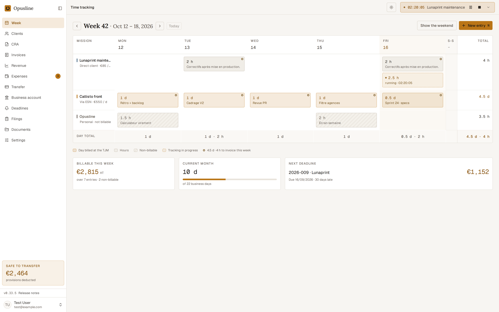

## A CRA your client will accept

A monthly compte-rendu d'activité as a French PDF: signed, sent, and matched
against the time you tracked, so the two cannot quietly diverge. Each mission
lists its reported, owed and signed months.

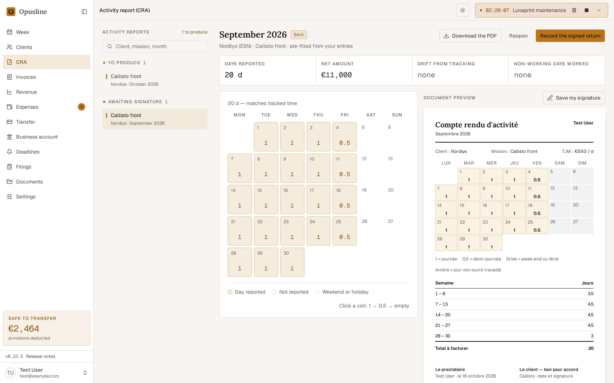

## Invoices, and the work behind them

Draft, sent, paid, late — with the tracked time each invoice covers. Record the
invoices your billing tool issues and file the PDF against them, or try the
editor in beta (below) and write them here. A payment that lands on the business
account is suggested for the invoice it settles.

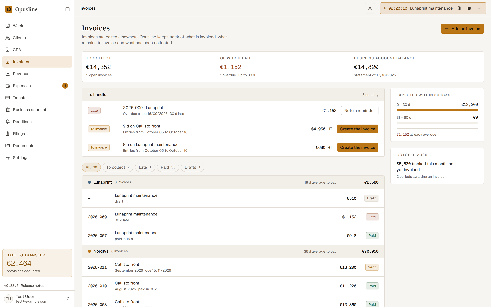

## Revenue, invoiced or collected

Both bases, because they answer different questions — one is what you billed,
the other is what the URSSAF will ask about. The year's ceiling, the versement
libératoire and the TVA franchise are checked against it.

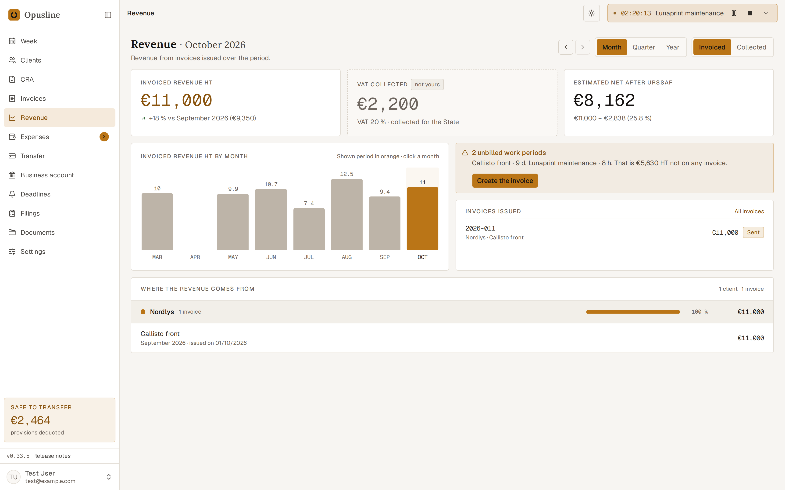

## Expenses, receipts and subscriptions

Every business purchase with its receipt, the TVA it carries and where that TVA
stands with the CA3. Drop a PDF receipt and Opusline reads the supplier, the
amounts and the date off it, on your server, or with Claude, scans and photos
included, if you paste your own Anthropic key. Subscriptions are expected month
after month and paired with the debits that pay them.

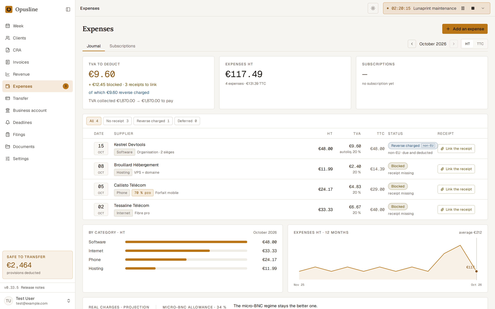

## Declarations, pre-filled

Each month's URSSAF and CA3 (or the year's CA12), the 2042-C PRO and the CFE,
from figures ready to retype on the portals, with the amount each one will take
provisioned the day it is known. Copy your avis d'imposition into the settings
and the income tax is set aside too.

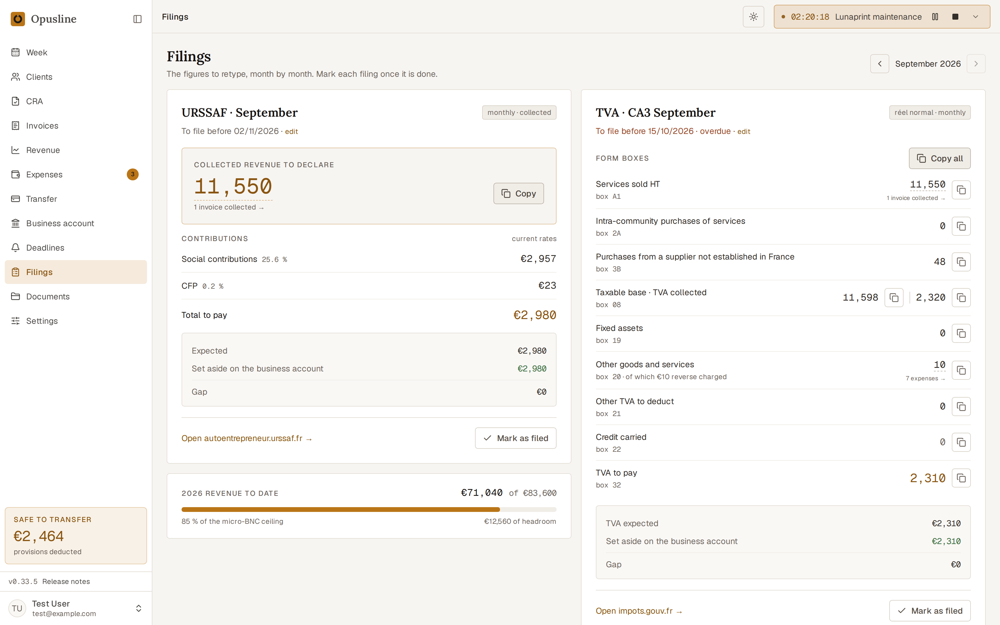

## How much can I pay myself?

The question Opusline exists for. Your business balance, minus what the fisc is
owed but has not yet asked for — TVA collected, URSSAF on the period's
collections, the CFE nobody remembers, the income tax, the subscriptions still
to be debited, and whatever cushion you told it to keep.

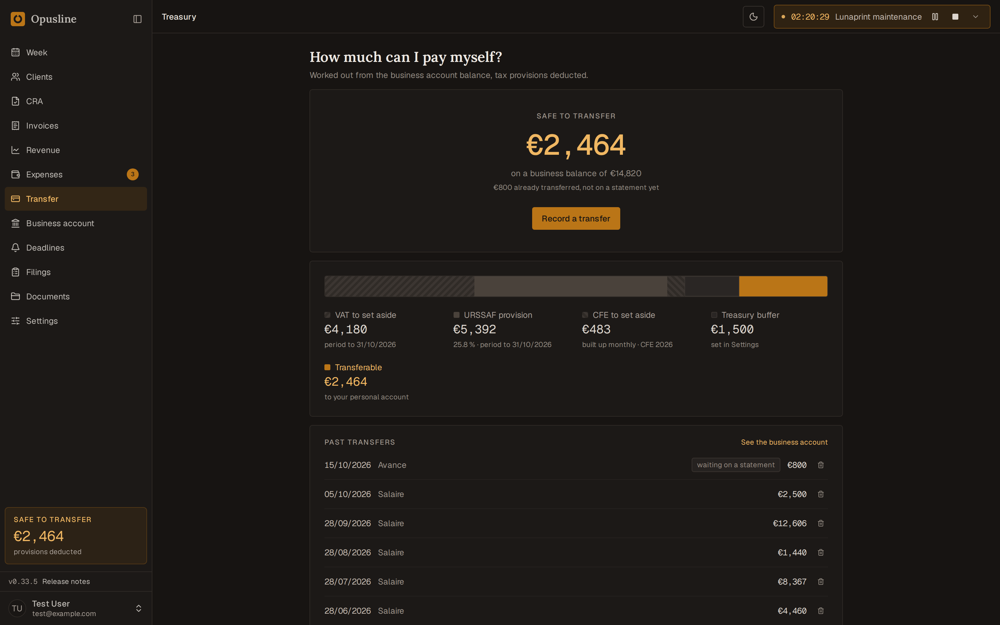

## Your business account

Connect the bank through your own Enable Banking application and Opusline fetches
the movements every night, or drop in the statement your bank exports — CSV,
OFX, QIF and CAMT.053 all parse. Each payment is suggested for an invoice, each
debit for an expense, and you validate in one click. Opusline only reads;
nothing moves money.

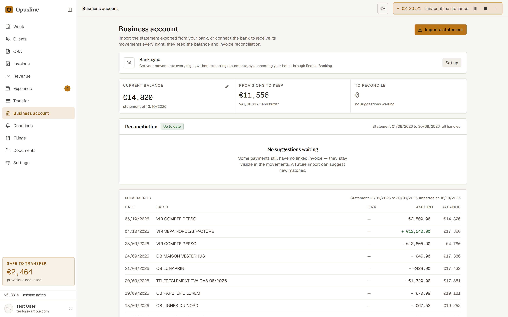

## Deadlines that come to you

URSSAF, TVA, CFE, income tax and unpaid invoices on one timeline, priced from
what you actually collected — cash basis, because that is how the micro-régime
works. Subscribe to it from any calendar app, and get an email a week before,
the day before and on the day.

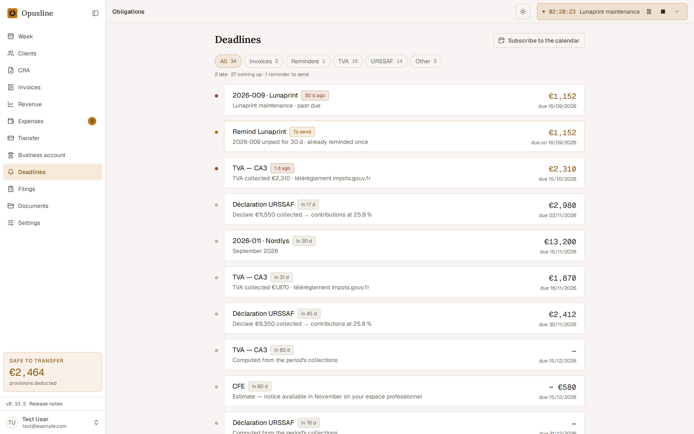

## On a phone

Every screen fits a phone: the week reads one day at a time, the timer opens
within thumb's reach, and the settings become tabs you swipe through.

<p align="center">
  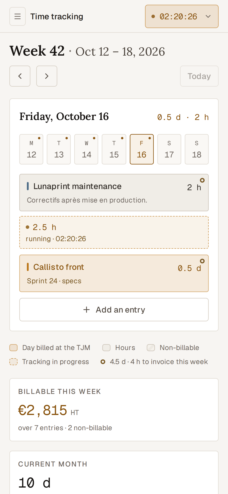
  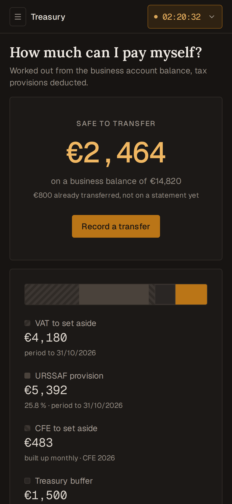
</p>

## And the rest

- **Security.** Two-factor authentication with an authenticator app and recovery
  codes, passkeys (Touch ID, Windows Hello, a security key), trusted browsers,
  an idle lock, and an email whenever the way into your account changes.
- **Documents.** Receipts, signed CRAs, issued invoices and anything else you
  file, found again under the client they belong to.
- **Clients and missions** with their colour, their TJM, their payment terms
  and their own page; dormant ones are archived overnight if you ask.
- **Backups** with one script, attached to every release, and an in-app note
  of when the last one ran.
- **Release notes in the app**, so an upgrade tells you what changed.

## Invoicing: in beta

Writing and issuing invoices *from* Opusline — catalogue of services, a live
French or English preview, continuous numbering, legal mentions checked against
the rules, the PDF filed at issue — is built and ships switched off behind
**Réglages → Avant-première**, where any account can opt in. Connecting a
*plateforme agréée* (Super PDP) for the 2026–2027 electronic-invoicing reform is
part of it: supplier e-invoices already land in Dépenses on their own.

Quotes, sending invoices by email, issuing them through the platform and
e-reporting are next; the
[roadmap](https://github.com/orgs/opusline/projects/1) tracks every step under
[#498](https://github.com/opusline/opusline/issues/498). Until it reads *done*
there, treat invoicing as a preview, not as what your accountant relies on.

---

## Run your own

Two images, published to GHCR on every release, for amd64 and arm64. On a VPS, a
home server or a NAS, about two minutes:

```bash
curl -fsSLO https://github.com/opusline/opusline/releases/latest/download/compose.prod.yaml
curl -fsSL -o .env https://github.com/opusline/opusline/releases/latest/download/example.env

# The one secret you must not lose.
docker run --rm ghcr.io/opusline/opusline-api:latest php artisan key:generate --show
```

Put that key in `APP_KEY`, set `DB_PASSWORD`, point `APP_URL` at your hostname,
then:

```bash
docker compose -f compose.prod.yaml up -d
```

Migrations run on start, so that is the whole install. Open the app and register
the first account — Opusline is single-tenant, so that account is yours.

**[Full guide →](docs/self-hosting.md)** — the
[compose file in full](docs/self-hosting.md#the-compose-file), TLS, backups,
upgrades, email, bank sync, and what each symptom means.

## Compared with Kimai

[Kimai](https://www.kimai.org) is the reference self-hosted time tracker, and a
good one. The difference is who each is built for.

| | Kimai | Opusline |
| --- | --- | --- |
| Built for | Teams: users, roles, customers, projects, activities, plugins | One freelance, no roles |
| Time tracking | Yes, with timesheets, approvals, exports | Yes, in days or hours, rounded as the mission bills |
| Invoicing | Templates from tracked time, many formats | Record issued invoices today; writing them in beta |
| Money after the invoice | Stops at the invoice | Payments matched on the business account, revenue invoiced vs collected, what you can pay yourself |
| French fiscality | No | URSSAF, TVA (CA3/CA12), CFE, 2042-C PRO, deadlines, provisions, CRA |
| Expenses | Plugin | Built in, with receipts and subscriptions |
| Licence | AGPL-3.0 | AGPL-3.0 |

If you run a team, or track time outside France, Kimai is the better fit. If you
are one freelance in France who wants the tax half handled, that is what this is.

## What it is not

- **Not multi-tenant.** One instance, one freelance. No teams, no roles, no
  invitations.
- **Not a bank.** It reads your movements — through your own Enable Banking
  application, or from a statement you export — and never initiates anything.
- **Not an accountant.** It computes provisions and pre-fills declarations. It
  does not file them, and it is not advice.
- **Not general-purpose.** The fiscal machinery is French: URSSAF, CA3/CA12, CFE,
  micro-BNC. Track time anywhere; the tax half only applies in France.

## Built with

Laravel on FrankenPHP, a React SPA on TanStack Router and Query, shadcn/ui on
Base UI, Tailwind v4. Postgres, MySQL and SQLite all pass the test matrix. The web
app compiles to static files — there is no second server runtime to operate.

## Working on Opusline

Prerequisites: Node.js 26 (the version in `.nvmrc`, which is the only one CI runs) with pnpm,
and Docker (PHP only runs in containers, through `apps/api/scripts/php.sh`).

```bash
pnpm install        # JS workspaces + git hooks
pnpm dev            # api (Docker stack), web on :3000, storybook on :6006
cd apps/api && sh scripts/php.sh php artisan migrate --seed
```

`--seed` builds the demo account (`test@example.com` / `password`);
`--seeder=VolumeSeeder` gives it three years of history, which is what these
screenshots show. Every name in it is fiction. Contributions welcome — see
[CONTRIBUTING.md](CONTRIBUTING.md), and [SECURITY.md](SECURITY.md) if you found
something that should not be filed in public.
The [roadmap](https://github.com/orgs/opusline/projects/1) shows what is in
progress and what comes next.

The stack in `apps/api/compose.yaml` is for development only — it builds from
your host's `vendor/` and bind-mounts the repository. `compose.prod.yaml` is the
one that deploys.

## License

[AGPL-3.0](LICENSE). Run it, change it, host it — if you host a modified version
for others, share the changes.
